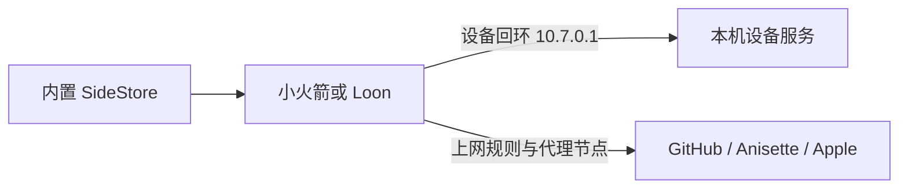

# SideStore + LiveContainer：安装、登录与手机端续签

这份中文教程整理了一次 Ubuntu + iPad 的实际操作：用 **iLoader 安装官方 LiveContainer + SideStore 一体包**，完成 Apple ID 登录，再用 **Shadowrocket（小火箭）或 Loon 的设备回环功能**替代 LocalDevVPN，让设备通信和上网代理同时工作。

适合第一次安装，或已经安装却遇到刷新失败的用户。本仓库是个人操作笔记，与上游项目没有官方隶属关系。

## 先选你的入口

| 现在的状态                                              | 从这里开始                                          |
| ------------------------------------------------------- | --------------------------------------------------- |
| 尚未安装                                                | [1. 安装与首次运行](docs/01-install.md)             |
| 电脑或 iPad 登录失败                                    | [2. Apple ID 与 Anisette](docs/02-login.md)         |
| 已安装，希望用小火箭 / Loon 续签                        | [3. VPN 回环与日常续签](docs/03-vpn-and-refresh.md) |
| 出现 `-1004`、NoVPN、配对失败或后台刷新失败             | [4. 按错误排查](docs/04-troubleshooting.md)         |
| Ubuntu iLoader 短信验证返回 403，且账号开启高级数据保护 | [5. 桌面兼容方案](docs/05-ubuntu-compat.md)         |
| 想知道哪些已经测试、哪些尚待验证                        | [版本、验证记录与参考](docs/06-evidence.md)         |

## 准备什么

- 一台电脑、一根能传输数据的 USB 线，以及 iPhone / iPad；本文电脑操作以 Ubuntu 为例。
- Apple ID 和能完成双重验证的受信任设备。
- 官方 [iLoader](https://iloader.app) 与 [LiveContainer + SideStore 一体包](https://github.com/LiveContainer/LiveContainer/releases)。下载时确认文件名包含 `+SideStore`。
- 一体包当前官方要求 iOS / iPadOS 15+；具体安装与 JIT 要求以[官方指南](https://livecontainer.github.io/docs/installation/lc_sidestore)为准。
- 以下 VPN 方案任选一个：小火箭的原生 `10.7.0.1/32` 回环，或 Loon **Build 1007+** 的回环插件。代理节点由你自行配置；需要能访问 GitHub 和 Apple 服务。

免费开发者签名通常有效 7 天，需要定期刷新。首次安装用电脑，配置成功后日常手动续签可在设备上完成；签名过期打不开时可能仍需电脑恢复。

## 已安装用户的最短操作顺序

1. 连接 Wi-Fi，关闭 LocalDevVPN。
2. **小火箭**：在「设置 → 其它」开启「包含路由 `10.7.0.1/32`」，重连 VPN。
   **Loon**：导入并启用 [Loon-SideStore-loopback.plugin](configs/Loon-SideStore-loopback.plugin)，重连 VPN。具体导入方法见 [VPN 教程](docs/03-vpn-and-refresh.md)。
3. 打开 LiveContainer 的内置 SideStore，进入 `Settings → Connection Configuration`：
   - 关闭 **Use Local VPN**。
   - **Remote Endpoint → Device IP** 填 `10.7.0.1`。
   - **RemotePair Port** 留空，点 **Confirm**，重新打开 SideStore。
4. `Settings → Anisette Servers` 选择 **jkcoxson**，核对地址为 `https://mac-ani.jkcoxson.com`，关闭 **Enable Auto Rotation**。若仍开启 On-Device Anisette，按[登录教程](docs/02-login.md)切换到远程服务后再验证。
5. Safari 打开[官方一体包软件源](https://github.com/LiveContainer/LiveContainer/releases/download/1.0/apps_ss_lc.json)。能看到 JSON 或下载文件，才算软件源可访问。
6. 查看 SideStore 的 Health Check：设备 **Reachable**、配对 **Verified**。然后在 **My Apps** 手动 **Refresh**，检查有效期是否延长。

如果以前设置过 Wi-Fi 手动代理，切换到小火箭 / Loon 时将「配置代理」恢复为关闭，避免继续依赖电脑代理。`10.7.0.1` 是回环方案使用的设备端点，不能当成代理服务器地址。

## 为什么换 VPN 能解决一部分刷新问题

续签依赖两条连接：SideStore 要通过互联网访问软件源、Anisette 和 Apple，也要通过本地通道访问这台 iPhone / iPad。LocalDevVPN 提供设备通道，但不会替你提供访问 GitHub 的代理出口。

仅有 VPN 图标、仅能打开网页，或仅能登录 Apple ID，都不足以证明续签成功。最终以 **设备可达、配对通过、Refresh 后有效期延长**为准。

## 本次实际结果

| 项目                      | 记录结论                                                                                       |
| ------------------------- | ---------------------------------------------------------------------------------------------- |
| Ubuntu iLoader 安装、登录 | 已完成；当时使用 iLoader 2.4.0                                                                 |
| iPad 内置 SideStore 登录  | 已完成；保持 iCloud 高级数据保护开启                                                           |
| 小火箭方案                | 用户反馈「小火箭在 anisette servers 选择 jkcoxson 成功了」；未单独记录有效期截图或自动续签结果 |
| Loon 方案                 | 插件与官方语法已核对，尚无本次设备实测回执                                                     |

本文保留实测版本用于追溯，安装时优先核对当前官方发行版。详细版本和证据见 [验证记录](docs/06-evidence.md)。

## 可复用文件

- [Loon 续签快捷指令](https://www.icloud.com/shortcuts/84320005e62e4f489e68dda6ee666aaa)与[Shadowrocket 续签快捷指令](https://www.icloud.com/shortcuts/12a9b698cb954686814a393794e518bc)：由原作者提供，导入和验证步骤见[后台与快捷指令](docs/03-vpn-and-refresh.md#后台与快捷指令)。
- [Loon 回环插件](configs/Loon-SideStore-loopback.plugin)：局部插件，可加到现有配置。
- [macOS 13.1 Anisette 字段示例](configs/SideStore-client-macOS13.1.json)：仅在对应登录兼容故障中使用。
- [Ubuntu 代理启动脚本](scripts/iloader-proxy.sh)与[可选 Anisette 中继](scripts/anisette-compat/relay.py)：用途、依赖和回退步骤见[桌面兼容教程](docs/05-ubuntu-compat.md)。

这些文件不包含代理订阅、账号、证书或配对数据。请使用自己的配置；报错反馈只附版本、操作位置和脱敏错误文字。
